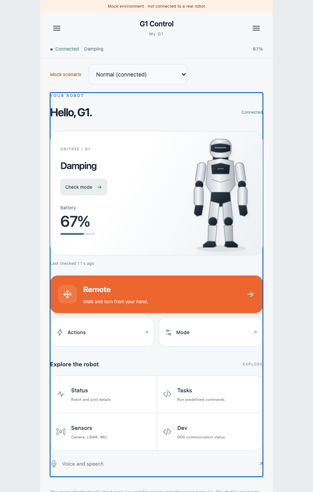
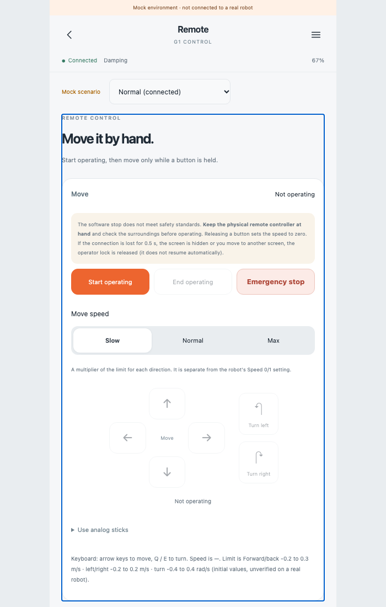

# g1-console

A small web console for the Unitree G1 humanoid robot. It runs on the robot's Jetson (PC2), shows the robot's state, and lets you operate it from a phone or a browser. `--mock` runs the whole thing without a robot. 日本語の概要は [README.ja.md](README.ja.md)。

> **WARNING — read before use.** This software can send walking commands, mode changes (including damping and zero torque) and an emergency stop to a real robot. The software stop is **not** a certified safety function. Use it only with the physical remote controller in reach, at least two people present, a clear area around the robot, and the robot hanging or seated for first tests. Most functions have **not** been verified on a real robot; the UI marks them. Use at your own risk. See the [LICENSE](LICENSE) (no warranty).

> **Unofficial.** This project is not affiliated with, endorsed by, or sponsored by Unitree Robotics. "Unitree" and "G1" are trademarks of their respective owners and are used here only to say which robot this works with.

> **Security model.** The server speaks plain HTTP. There is no TLS. The login cookie holds the raw token (`HttpOnly`, `SameSite=Strict`, no `Secure`), the startup log prints the token, and `/login?token=…` puts it in a URL. Anyone on the same network who can read the traffic can take the token. With `--no-auth`, anyone on the network can drive the robot. By default the server binds to `127.0.0.1` only. Opening it on a Wi-Fi interface (`--bind-iface wlan0`) requires token authentication. Use it only on a network you trust.

## What it is

`g1-console` is a hub plus a web UI for the Unitree G1. The hub is a single Python process (`server.py`, standard library only). It talks to the robot through helper processes that run on the robot's Jetson, and it serves a web UI that is usable from a phone.

It reproduces part of what the physical remote controller does, through the SDK, and adds monitoring and a few developer tools. How the physical remote controller's functions map to SDK calls is written up in [docs/REMOTE_CONTROLLER.md](docs/REMOTE_CONTROLLER.md).

Every function that has not been tried on a real robot is marked as unverified in the UI. The flags live in `FEATURES` in [`g1console/modes.py`](g1console/modes.py) and in the `verified` field of each task definition.

## Features

- **Connection status.** Three stages (hub, Jetson, G1) with the time of the last successful read, and automatic reconnection.
- **Mode switching.** Damping, Zero Torque, Locked Standing, Seated Mode, Squat <-> Stand, Lie -> Stand and Regular Mode, limited to the transitions listed in `TRANSITIONS` in `g1console/modes.py`. The hub rejects any FSM ID that is not in `BUTTONS`. Two speed-mode buttons (Speed 0 and Speed 1) are also provided; which one is slow and which is fast is unverified.
- **Motion.** A joystick or the arrow keys send velocity commands (`SetVelocity`). Control requires an operator lock (the session that holds control). The hub clamps velocities and stops the robot when commands stop arriving. An emergency stop (e-stop) button is always shown. Available only with `--local` or `--mock`.
- **Actions.** Wave, wave with a turn, and handshake start and end (`SetTaskId`). The task numbers and their effects are inferred from SDK material and are unverified. Available only with `--local` or `--mock`.
- **Telemetry.** Battery, IMU, odometry, main board, Jetson, physical remote controller input, emergency stop state and the 29 joints.
- **Audio and LED.** Speaker volume, head LED color and text to speech.
- **Camera and LiDAR.** RGB and depth video and a LiDAR point cloud, relayed by the hub. The streamers are off by default and start only when you press the button in the console. The LiDAR unit itself can also be set to idle or sampling (`--local` or `--mock` only).
- **Tasks.** Predefined commands from `tasks/*.json` (no shell strings), with start, stop, logs and exclusive groups.
- **DDS.** A ledger of known topics and services, subscription to a fixed set of message types, and publishing of `String_` messages only to topics on a server-side allowlist.
- **Caution dialog.** Pressing a button for a function that is marked unverified opens a caution dialog. Its default choice is to cancel.
- **Hub stop.** The settings screen can stop the hub. It refuses while a task is running or an operator lock is held.
- **Mock.** `--mock` runs everything without hardware and offers selectable mock scenarios (normal, G1 not responding, Jetson unreachable, debug mode).

The screens and the API endpoints behind them are listed in [docs/MOBILE_UI.md](docs/MOBILE_UI.md).

Screenshots taken with `--mock` (simulated data, no robot connected):

| Home | Remote |
|---|---|
|  |  |

## Quick start (no robot needed)

```bash
python3 server.py --mock
```

Then open <http://127.0.0.1:18790/>. The state shown is simulated and nothing is sent to a robot. The hub needs Python 3.8 or later and nothing else. `--mock` and `--local` cannot be combined.

## Running on a Jetson

Run the hub on the robot's Jetson, so that the helper processes and the camera and LiDAR streamers are local processes (no ssh):

```bash
python3 server.py --local                        # loopback only, no authentication
python3 server.py --local --bind-iface wlan0     # also listen on wlan0 (token required)
```

The full procedure (what to copy to the Jetson, the optional systemd unit, checks) is in [docs/JETSON_SETUP.md](docs/JETSON_SETUP.md). The helper processes look for `unitree_sdk2_python` in the directory given by the environment variable `UNITREE_SDK_DIR` (default `~/unitree_sdk2_python`).

Without `--local` and `--mock`, `server.py` runs the helper over `ssh` on the Jetson set in the settings screen (or `--host`). That mode is only partly supported: motion, actions, topics and LiDAR sensor control are not available in it. It has been run only from a macOS machine; Windows is unverified.

Options (`python3 server.py --help` is authoritative):

| Option | Purpose |
|---|---|
| `--mock` | Run without hardware (simulated state). |
| `--local` | Run on the Jetson itself: helpers, camera and LiDAR run locally, no ssh. |
| `--host HOST` | ssh target of the Jetson (ssh mode only). |
| `--port PORT` | Listening port (default 18790). |
| `--bind IP` | IPv4 address to listen on; may be repeated. `0.0.0.0` is refused. |
| `--bind-iface NAME` | Also listen on the IPv4 address of this interface, for example `wlan0`. |
| `--allow-host NAME` | Extra `Host` header value to accept, for example an mDNS name. |
| `--require-token` | Require the token even on loopback. |
| `--no-auth` | Do not require the token on non-loopback addresses. See Authentication. |
| `--tasks-dir DIR` | Directory with task definitions (default `tasks/`). |
| `--topics-file FILE` | Publish allowlist for the DDS screen (default `data/topics.json`; if the file is missing, nothing can be published). |
| `--camera-url URL` | URL of a `camera_stream.py` that was started by hand on the Jetson. |

## Authentication

- By default the hub listens on `127.0.0.1` only and requires no token.
- If it listens on any non-loopback address (`--bind` or `--bind-iface`), token authentication is mandatory. The token is stored in `~/.g1console/token` (mode 0600, generated on first start). The startup log prints a login URL of the form `http://<IP>:18790/login?token=...`. Opening it once sets a cookie (`HttpOnly`, `SameSite=Strict`). API clients can send `Authorization: Bearer <token>` instead.
- The `Host` header must be a listening address, a loopback name, or a name added with `--allow-host`. POST requests must carry an `Origin` that matches.
- Five failed token attempts within 60 seconds lock out further attempts for 30 seconds.
- `--no-auth` removes the token requirement on non-loopback addresses (the `Host` and `Origin` checks stay). Anyone on the same network can then change modes and drive the robot. Use it only on a closed network where everyone is trusted. It cannot be combined with `--require-token`, and the startup log prints a warning.
- The transport is plain HTTP, so anyone who can read the traffic can read the token. The software stop is not a certified safety function; the physical remote controller is the last line of defense.

## Supported hardware and what is unverified

- Confirmed environment: Unitree G1 29DoF, Jetson Orin NX, L4T R35.3.1, `ai_sport` 8.7.3.4. Everything else is unverified, including other G1 variants, other Jetson models and other firmware versions.
- Even in that environment most functions have not been verified through the console. In `FEATURES` in `g1console/modes.py`, only movement, battery display and telemetry display are marked verified, each on the operator's report (2026-10-18 and 2026-10-24); the note on each entry says what was and was not covered. The open items are tracked in [docs/REAL_ROBOT_CHECKLIST.md](docs/REAL_ROBOT_CHECKLIST.md).
- Unverified, among others: the effect of `SetFsmId` for most transitions, the action task numbers, the speed modes, the velocity limits, audio and LED through the console (the operator's confirmation is incomplete), running the hub under systemd on the Jetson, and the phone layout.
- Not implemented: Running Mode (its FSM ID is unconfirmed), switching to debug mode, and speech recognition.

## Directory layout

```
g1-console/
├── server.py          Entry point: HTTP server, authentication gate, helper calls
├── g1console/         Python modules used by the hub (modes, motion, auth, tasks, topics, api_spec, ...)
├── web/               Browser UI (index.html, ui-core.js, mobile.js, mobile.css)
├── jetson/            Files that run on the Jetson (helpers, streamers, ctl scripts, systemd unit)
├── tasks/             Task definitions (*.json)
├── tests/             Automated tests (no robot or ssh needed)
├── docs/              Design, API definition, setup, checklist
└── settings.json      Saved settings (created at runtime, not in git)
```

## How it fits together

```
browser --HTTP--> server.py (hub, 127.0.0.1:18790, optionally wlan0)
                    |-- LocalHelper      -> jetson/remote_helper.py -> DDS (eth0) -> G1   state, modes, audio, LED
                    |-- MotionController -> jetson/motion_helper.py -> DDS -> G1          velocity commands
                    |-- camera_ctl.sh / lidar_ctl.sh -> camera_stream.py / lidar_stream.py   on demand
                    |-- TaskRunner       -> tasks/*.json child processes                    on demand
                    `-- topic_helper.py  (DDS screen)                                       on first use
```

Details, timing constants and design decisions are in [docs/DESIGN.md](docs/DESIGN.md).

## Tests

```bash
bash tests/run_tests.sh
```

No robot or ssh is needed (mock helpers and the standard library only). The mobile UI also has two Node scripts, described in [docs/MOBILE_UI.md](docs/MOBILE_UI.md).

## API documentation

- [docs/API.md](docs/API.md): API reference.
- [docs/openapi.yaml](docs/openapi.yaml): OpenAPI definition.

Both are generated from [`g1console/api_spec.py`](g1console/api_spec.py). Do not edit them by hand; regenerate them with:

```bash
python3 g1console/api_spec.py
```

`GET /api` on a running hub returns the same definition as JSON.

## Runtime dependencies

- The hub (`server.py` and `g1console/`) uses only the Python standard library.
- On the Jetson, the helper processes in `jetson/` need `unitree_sdk2_python` (BSD-3-Clause) and its dependency `cyclonedds` (EPL-2.0 / EDL-1.0).
- The camera and LiDAR streamers optionally use `numpy`, `opencv-python` and `pyrealsense2`.
- None of these are included in or redistributed by this repository. Install them on the Jetson yourself and check their licenses. The list with licenses is in [docs/THIRD_PARTY.md](docs/THIRD_PARTY.md).

## Safety notes for real-robot use

- Do not operate from the console and the physical remote controller at the same time. The remote controller input goes straight to the robot, not through the SDK, so the console display and the robot can disagree.
- Another process on the Jetson may already hold control of the robot (for example a walking relay). Switching modes from the console can conflict with it.
- For first tests, hang the robot from a gantry or keep a clear area around it. Damping and zero torque make a standing robot fall.
- The effect of `SetFsmId` on a real robot is largely unverified. Start with low-risk transitions such as Seated Mode or standing up.
- Do not expose the hub on a network you do not trust.

## Related projects

This is one of several tools for the G1. Others you may want to compare (I have not tested them with this project):

- [UniRoboGui](https://github.com/ershui2500/UniRoboGui) (MIT): a C++ web GUI and dashboard for several Unitree robots, with SLAM, point clouds and speech features.
- [unitree_sdk2](https://github.com/unitreerobotics/unitree_sdk2) (BSD-3-Clause): Unitree's official C++ SDK.

The difference here: a hub that needs only the Python standard library, `--mock` for working without a robot, and a UI that marks every function not yet verified on a real robot.

## About how this was written

Much of the code, tests and documentation was written with the help of an AI coding assistant (Claude by Anthropic) under the maintainer's direction. Read the code before you run it on a robot, and see the warning at the top.

## License

MIT. See [LICENSE](LICENSE). Third-party components are not covered by this license; see Runtime dependencies. The robot illustration and the icons in `web/index.html` are inline SVG that is part of this repository and covered by the same license. They are a generic drawing, not artwork supplied by Unitree.
